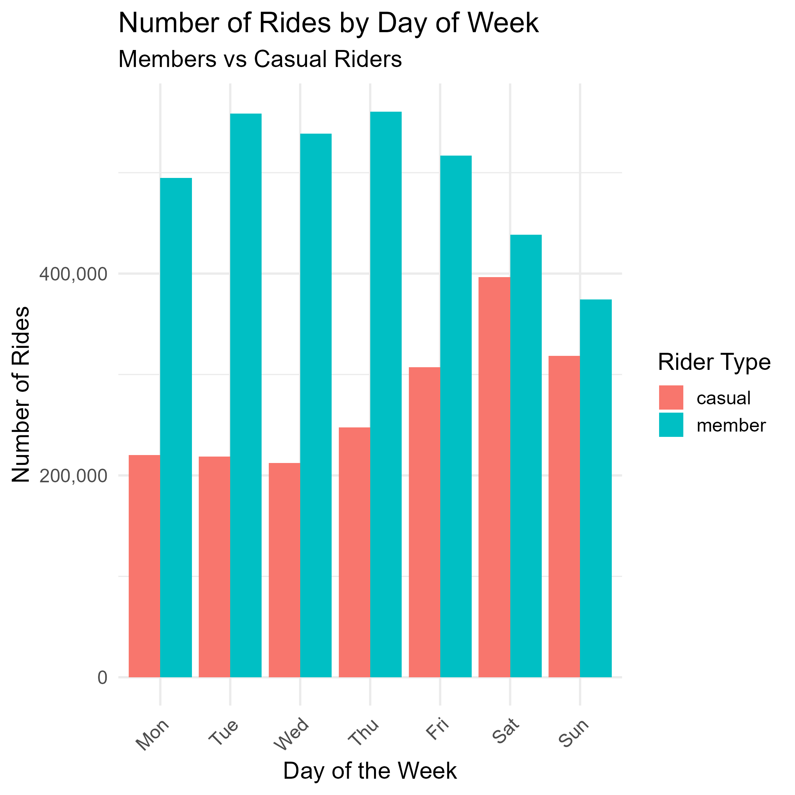
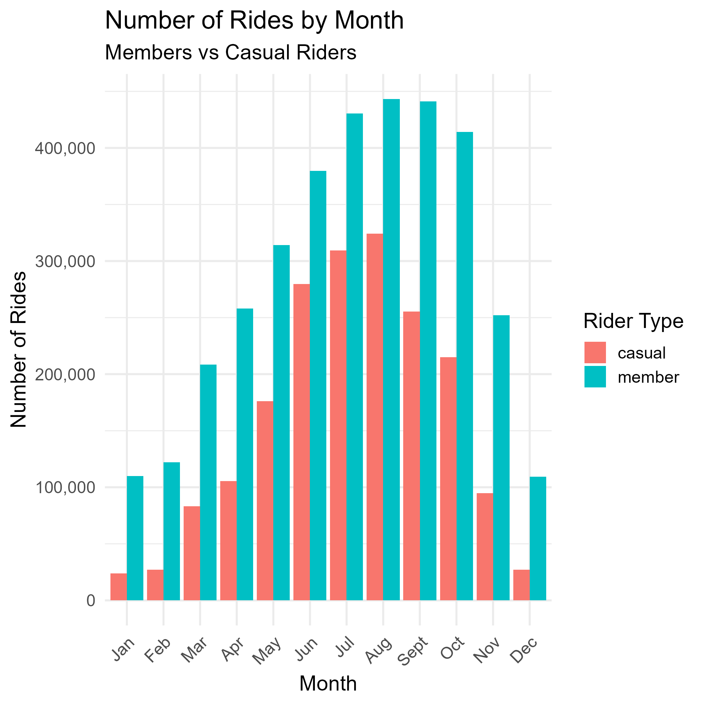
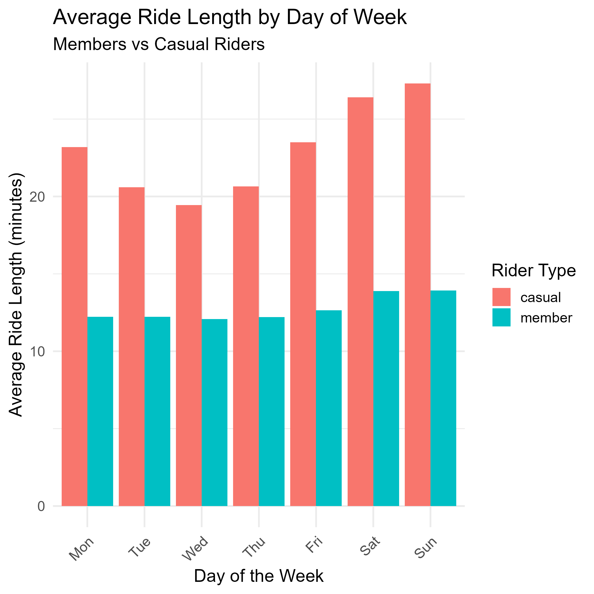

# 🚴 Cyclistic Bike-Share Analysis

## 📌 Overview

This project presents an end-to-end data analysis of Cyclistic bike-share data as part of the Google Data Analytics Certificate capstone.

The analysis covers over **5.4 million cleaned bike-share trips (February 2025 to January 2026)** and focuses on understanding how different rider types use the service. The goal is to generate insights that support marketing strategies aimed at converting casual riders into annual members.

🔗 **[View Full Report (HTML)](https://daniel-eniola.github.io/cyclistic-bike-share-analysis/cyclistic_analysis.html)**

*Also available on: [RPubs](https://rpubs.com/DanielEniola/cyclistic-bike-share-analysis) · [Kaggle](https://www.kaggle.com/code/danieleniola/cyclistic-bike-share-analysis)*

---

## ❓ Business Question

**How do annual members and casual riders use Cyclistic bikes differently?**

This question is explored through data cleaning, feature engineering, exploratory analysis, and visualization.

---

## 🛠 Tools & Technologies

* **R**: data cleaning, analysis, and visualization
* **tidyverse**: data manipulation
* **ggplot2**: data visualization
* **scales**: formatting and presentation

> Note: the `janitor` package is loaded in the code but was not used in the analysis.

---

## 🧰 Project Highlights

* Processed **5,552,092 ride records**
* Removed **148,401 invalid rides** (under 1 minute or negative durations), leaving **5,403,691** for analysis
* Engineered new variables such as ride length, day of week, and month
* Identified behavioral patterns using grouped summaries and visualizations
* Translated insights into **actionable business recommendations**

---

## 🔍 Key Insights

* Casual riders average **23.5 minutes per ride**, nearly **twice as long** as members (12.7 minutes)
* Members account for about **64% of all rides** (**3.48 million vs 1.92 million**)
* Casual riders peak on **weekends**, especially Saturday and Sunday, showing leisure behavior
* Members ride more frequently on **weekdays**, consistent with commuting and routine usage
* Casual ridership is highly **seasonal**, with sharp declines in winter, while members remain relatively consistent year-round

---

## 📊 Visualisations

---

## 💡 Recommendations

* 📈 Launch targeted **weekend conversion campaigns** starting Thursday to reach casual riders at their peak usage
* 🚲 Test positioning memberships around **weekday convenience and routine rides**, since casual weekday usage is low
* 🌤 Introduce **pre-summer promotions (March to April)** to convert riders before peak season

---

## ⚠️ Limitations

* Only rides under 1 minute were removed, so very long rides (up to about 1,575 minutes) remain and raise the casual average. Median ride length would be a more robust comparison.
* Time of day was not analysed, so the commuting interpretation is an inference from day-of-week patterns.
* The PDF and HTML reports describe member peaks as "weekday mornings", but time of day was not analysed, so read this as "weekdays".

---

## 🗂 Data Notes

* The analysis uses 12 monthly files, from `202502-divvy-tripdata` to `202601-divvy-tripdata`.
* The CSV inside `202601-divvy-tripdata.zip` is mislabelled `202501-divvy-tripdata.csv` by Divvy, but it contains **January 2026** data. The real January 2025 file is not used.
* The raw data is not stored in this repository because of its size.

---

## 📁 Project Files

* `cyclistic_analysis.Rmd`: full analysis with code and methodology
* `cyclistic_analysis.html`: knitted report (view it via the link above)
* `cyclistic_analysis.pdf`: presentation-ready report
* `.png` files: exported visualizations

---

## 📊 Data Source

[Divvy Trip Data](https://divvy-tripdata.s3.amazonaws.com/index.html)
Provided by Motivate International Inc. under public license.

---

*Analysis completed by Daniel Eniola*
